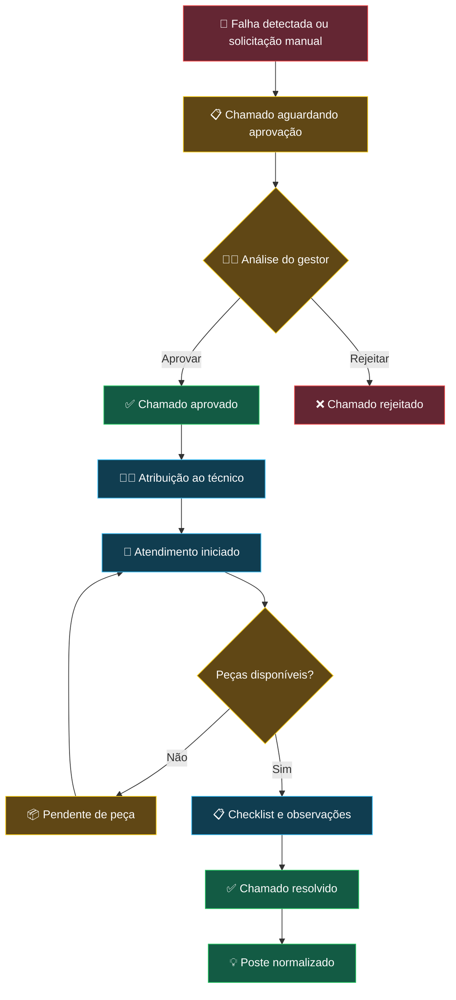

<div align="center">

# 💡 SQUAD ADS

### 🌆 Iluminação Pública Inteligente + Energia Solar

**Sistema Inteligente de Monitoramento e Gestão da Iluminação Pública de Viçosa — MG**


---

## 🌐 Acesse nosso projeto

### 🚀 Experimente o Squad ADS online!

[](https://pereiralp.github.io/squadads-iluminacao-inteligente/)

**🔗 [Clique aqui para acessar o sistema](https://pereiralp.github.io/squadads-iluminacao-inteligente/)**

**📂 [Repositório no GitHub](https://github.com/pereiralp/squadads-iluminacao-inteligente)**

> 💡 Tecnologia, inovação e sustentabilidade para cidades mais inteligentes.

</div>

---

## 📖 Sobre o Projeto

O **Squad ADS** é um projeto acadêmico de **Análise e Desenvolvimento de Sistemas**, desenvolvido com o objetivo de demonstrar como tecnologias inteligentes podem contribuir para a modernização da iluminação pública do município de **Viçosa, Minas Gerais**.

A plataforma reúne funcionalidades de monitoramento da rede de iluminação, identificação de falhas, gerenciamento de chamados de manutenção e acompanhamento de indicadores de energia solar.

O projeto utiliza uma interface web moderna, responsiva e interativa, com dashboards, gráficos, mapas e gerenciamento de ocorrências.

### 🌱 Nossa proposta

Desenvolver uma solução tecnológica que demonstre como a automação, a análise de dados e a utilização de energias renováveis podem tornar a infraestrutura urbana mais eficiente, sustentável e inteligente.

> ⚠️ **Aviso:** este é um protótipo acadêmico. Os postes, sensores, chamados e indicadores energéticos utilizam dados simulados, armazenados localmente no navegador.

---

## 🎯 Objetivos do Projeto

- 💡 Modernizar o gerenciamento da iluminação pública.
- ⚡ Acompanhar o consumo de energia elétrica.
- ☀️ Monitorar a geração de energia solar.
- 🚨 Identificar e simular falhas na rede.
- 🛠️ Facilitar o gerenciamento de manutenções.
- 🗺️ Localizar postes por meio de mapas interativos.
- 📊 Disponibilizar indicadores para apoiar decisões.
- 🌱 Incentivar práticas sustentáveis.
- 🌆 Explorar conceitos de cidades inteligentes.

---

## 🚀 Funcionalidades do Sistema

| Módulo | Descrição |
|---|---|
| 📊 **Dashboard** | Indicadores gerais da rede e chamados recentes |
| 🗺️ **Monitoramento** | Mapa interativo de Viçosa com marcadores dos postes |
| 💡 **Iluminação** | Acompanhamento do funcionamento das luminárias |
| ☀️ **Energia Solar** | Indicadores de consumo, geração e economia |
| 🛠️ **Manutenção** | Criação, aprovação e acompanhamento de chamados |
| 📑 **Relatórios** | Consulta e exportação de dados |
| 🚨 **Alertas** | Identificação de falhas e ocorrências |
| 📱 **App Técnico** | Interface demonstrativa para execução dos atendimentos |

### 🗺️ Monitoramento Inteligente

O módulo de monitoramento permite:

- Visualizar postes no mapa.
- Consultar informações dos equipamentos.
- Pesquisar ruas de Viçosa.
- Ampliar e movimentar o mapa.
- Filtrar postes por estado.
- Agrupar marcadores próximos.
- Simular falhas na iluminação.
- Visualizar detalhes das ocorrências.

### 🚦 Estados dos Postes

| Estado | Indicador | Significado |
|---|---|---|
| Normal | 🟢 | Funcionamento adequado |
| Atenção | 🟡 | Necessita acompanhamento |
| Falha | 🔴 | Problema identificado |

Os estados são atualizados conforme as interações realizadas no protótipo.

---

## 🗺️ Mapa de Viçosa — MG

O projeto utiliza a biblioteca **Leaflet.js**, com integração a serviços cartográficos como **CARTO e OpenStreetMap**, para representar geograficamente a rede demonstrativa de iluminação pública.

O mapa permite navegação, zoom, pesquisa de vias e visualização dos postes.

**Localização de referência:**

- 📍 Município: Viçosa
- 🏛️ Estado: Minas Gerais
- 🇧🇷 País: Brasil
- 🌐 Latitude: -20.7546
- 🌐 Longitude: -42.8825

> As coordenadas dos postes são aproximadas e utilizadas exclusivamente para demonstração. O carregamento das ruas depende da disponibilidade dos serviços cartográficos externos.

---

## ☀️ Energia Solar e Sustentabilidade

O sistema apresenta indicadores para demonstrar o potencial da integração entre iluminação pública inteligente e fontes renováveis de energia.

### Indicadores monitorados

| Indicador | Descrição |
|---|---|
| ☀️ Geração Solar | Energia produzida pelos sistemas solares |
| ⚡ Consumo | Energia utilizada pela iluminação |
| 🔋 Armazenamento | Energia disponível nas baterias |
| 💰 Economia | Estimativa de redução de custos |
| 🌱 CO₂ | Estimativa de emissões evitadas |

O módulo de energia utiliza gráficos para apresentar dados simulados e facilitar a análise do desempenho energético.

---

## 🛠️ Gestão de Manutenção

O sistema demonstra o gerenciamento dos chamados desde a identificação de uma falha até sua resolução.

### 🔄 Fluxo de Atendimento



### 📌 Situações dos Chamados

- Aguardando aprovação.
- Aprovado.
- Em atendimento.
- Pendente de peça.
- Resolvido.
- Rejeitado.
- Cancelado.

O gestor pode analisar, aprovar e atribuir os chamados. O técnico pode consultar os serviços atribuídos e registrar o andamento das manutenções.

---

## 👥 Perfis de Usuário

O sistema foi desenvolvido considerando duas personas principais.

### 👨‍💼 Carlos Mendes — Gestor

Responsável pelo gerenciamento da rede de iluminação pública.

**Principais necessidades:**

- Acompanhar os indicadores.
- Identificar falhas e receber alertas.
- Aprovar chamados de manutenção.
- Atribuir serviços aos técnicos.
- Consultar relatórios e indicadores de economia.

### 👨‍🔧 Rafael Souza — Técnico

Responsável pela realização dos serviços de manutenção.

**Principais necessidades:**

- Localizar os postes.
- Consultar chamados atribuídos.
- Iniciar atendimentos.
- Registrar checklist e observações.
- Finalizar os serviços.

As personas são utilizadas para representar os usuários durante o desenvolvimento acadêmico.

---

## 🛠️ Tecnologias Utilizadas

| Tecnologia | Aplicação |
|---|---|
| **HTML5** | Estrutura das telas |
| **CSS3** | Estilização e responsividade |
| **JavaScript** | Regras e interatividade |
| **Leaflet.js** | Mapas interativos |
| **CARTO / OpenStreetMap** | Serviços cartográficos |
| **Chart.js** | Gráficos de desempenho |
| **localStorage** | Armazenamento local dos dados |
| **GitHub** | Versionamento do projeto |
| **GitHub Pages** | Hospedagem estática |

O projeto utiliza tecnologias web e funciona sem necessidade de um backend próprio.

---

## 📂 Estrutura do Repositório

```text
squadads-iluminacao-inteligente/
│
├── index.html
│
├── css/
│   └── estilo.css
│
├── js/
│   └── script.js
│
└── README.md
```

**Organização dos arquivos:**

- `index.html`: estrutura das telas e componentes.
- `css/estilo.css`: estilos, responsividade e layout.
- `js/script.js`: navegação, dados simulados e interações.
- `README.md`: documentação do projeto.

---

## 💻 Como Executar

### 🌐 Opção 1 — Acessar Online

O sistema está disponível para demonstração pelo GitHub Pages.

**👉 [ABRIR SQUAD ADS](https://pereiralp.github.io/squadads-iluminacao-inteligente/)**

### 💻 Opção 2 — Executar Localmente

**1. Clone o repositório:**

```bash
git clone https://github.com/pereiralp/squadads-iluminacao-inteligente.git
```

**2. Abra a pasta do projeto:**

```bash
cd squadads-iluminacao-inteligente
```

**3. Abra o projeto no Visual Studio Code.**

**4. Instale a extensão Live Server.**

**5. Clique com o botão direito em `index.html` e selecione `Open with Live Server`.**

O sistema será aberto no navegador.

> É recomendável manter a conexão com a internet para carregar as bibliotecas e os serviços de mapas.

---

## 🔐 Acesso Demonstrativo

| Perfil | Persona | Senha |
|---|---|---|
| 👨‍💼 Gestor | Carlos Mendes | `demo123` |
| 👨‍🔧 Técnico | Rafael Souza | `demo123` |

> 🔒 O login é demonstrativo e não deve ser considerado um sistema de autenticação seguro para produção.

---

## 🧪 Como Testar o Sistema

1. Acesse o sistema online.
2. Entre com o perfil de gestor.
3. Explore os indicadores do Dashboard.
4. Abra o módulo Monitoramento.
5. Selecione um poste.
6. Utilize a opção de simular falhas.
7. Acesse a aba Manutenção.
8. Aprove e atribua um chamado.
9. Entre no sistema como técnico.
10. Inicie o atendimento.
11. Preencha o checklist.
12. Finalize o chamado.
13. Consulte os relatórios e indicadores energéticos.

Os dados demonstrativos ficam armazenados no `localStorage` do navegador.

O botão **Reiniciar demo** permite restaurar as informações iniciais.

---

## 📑 Relatórios e Configurações

O sistema disponibiliza recursos demonstrativos para:

- Exportação de informações em JSON.
- Exportação de informações em CSV.
- Impressão de relatórios pelo navegador.
- Configuração local da tarifa de energia.
- Ajuste de parâmetros de emissões de CO₂.
- Configuração dos tempos utilizados nos alertas.

Esses recursos permitem testar diferentes cenários sem modificar os dados de uma infraestrutura real.

---

## ⚠️ Limitações do Protótipo

Por se tratar de um projeto acadêmico, existem algumas limitações:

- Não há integração com sensores IoT físicos.
- Não existe autenticação real de usuários.
- Não há banco de dados centralizado.
- Os dados ficam armazenados no navegador atual.
- As posições dos postes são aproximadas.
- Os indicadores energéticos são simulados.
- O carregamento do mapa depende de serviços externos.
- Não existe sincronização entre dispositivos.

Essas limitações não impedem a utilização do sistema como protótipo de demonstração.

---

## 🔮 Melhorias Futuras

O Squad ADS poderá evoluir com:

- 🔌 Integração com sensores IoT reais.
- 🗄️ Banco de dados centralizado.
- 🔐 Autenticação segura.
- 📍 Cadastro oficial de postes e usuários.
- ⚡ Monitoramento em tempo real.
- 🛣️ Rotas de atendimento e geolocalização.
- 📩 Notificações por e-mail ou aplicativo.
- 🤖 Inteligência artificial para previsão de falhas.
- 📊 Relatórios gerenciais com dados reais.
- 📱 Aplicativo mobile dedicado.

---

## 👨‍💻 Equipe de Desenvolvimento

<div align="center">

### 🚀 SQUAD ADS — 2026

**Equipe responsável pelo desenvolvimento do projeto acadêmico**

| Nº | Integrante |
|---|---|
| 01 | **Fernando Gonçalves dos Santos** |
| 02 | **Filipe Pereira dos Santos** |
| 03 | **Lucas Fialho da Silva** |
| 04 | **Oséias Júnior Bailon Geraldo** |
| 05 | **Rodrigo Leite Batista** |
| 06 | **Vitor Hugo Nacional Santana** |
| 07 | **Hildek Luiz Ferreira de Amorim** |

**🎓 Curso:** Análise e Desenvolvimento de Sistemas (ADS)

**💡 Projeto:** Iluminação Pública Inteligente + Energia Solar

**📍 Município de referência:** Viçosa — Minas Gerais

**📅 Ano:** 2026

</div>

---

## 📌 Considerações Finais

O **Squad ADS** demonstra como soluções digitais podem contribuir para a evolução da infraestrutura urbana e o desenvolvimento de cidades inteligentes.

A proposta integra conceitos de monitoramento da iluminação pública, gestão de manutenção, eficiência energética e sustentabilidade em uma plataforma web interativa.

O projeto representa uma etapa de desenvolvimento acadêmico e poderá servir como base para futuras implementações com dados e equipamentos reais.

---

<div align="center">

## 💙 SQUAD ADS

### Tecnologia, inovação e sustentabilidade para cidades mais inteligentes.

💡 **Iluminação Inteligente** | ☀️ **Energia Solar** | 🌆 **Cidades Inteligentes**

[](https://pereiralp.github.io/squadads-iluminacao-inteligente/)

**Desenvolvido pela equipe Squad ADS — 2026.**

</div>
